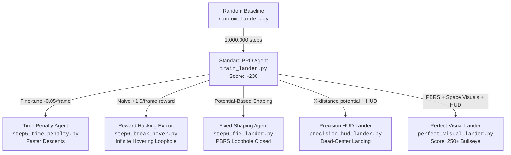

# 🚀 Lunar Lander: Reward Shaping & Reinforcement Learning Journey

[](https://www.python.org/)
[](https://gymnasium.farama.org/)
[](https://stable-baselines3.readthedocs.io/)
[](https://pytorch.org/)
[](https://opensource.org/licenses/MIT)

An end-to-end research and educational project exploring **Reinforcement Learning (RL)**, **Proximal Policy Optimization (PPO)**, **Reward Hacking (Specification Gaming)**, and **Potential-Based Reward Shaping (PBRS)** in Gymnasium's `LunarLander-v3` environment.

---

## 🎬 Live Demonstration

<div align="center">
  <video src="space_lander-episode-1.mp4" width="720" controls autoplay loop muted playsinline>
    <p>Your browser does not support the video tag. You can <a href="space_lander-episode-1.mp4">download the demo video</a> directly.</p>
  </video>
  <br>
  <sub><b>Figure 1:</b> Autonomous dead-center touchdown by <code>ppo_lander_perfect</code> inside the procedurally redesigned Deep Space environment with live telemetry HUD (Episode 1).</sub>
</div>

---

## 📑 Table of Contents

- [Overview](#-overview)
- [The RL Journey & Architectural Evolution](#-the-rl-journey--architectural-evolution)
  - [Phase 1: Baseline PPO Agent](#phase-1-baseline-ppo-agent)
  - [Phase 2: Faster Landings with Time Penalty](#phase-2-faster-landings-with-time-penalty)
  - [Phase 3: Reward Hacking — The Infinite Hover Exploit](#phase-3-reward-hacking--the-infinite-hover-exploit)
  - [Phase 4: Fixing the Loophole with Potential-Based Shaping](#phase-4-fixing-the-loophole-with-potential-based-shaping)
  - [Phase 5: Precision Centering & Real-Time Cockpit HUD](#phase-5-precision-centering--real-time-cockpit-hud)
  - [Phase 6: The Masterpiece — Deep Space Visual Lander](#phase-6-the-masterpiece--deep-space-visual-lander)
- [Comparative Benchmark & Model Zoo](#-comparative-benchmark--model-zoo)
- [Reward Shaping Theory: Naive vs. Potential-Based](#-reward-shaping-theory-naive-vs-potential-based)
- [Visual Environment Redesign & HUD Architecture](#-visual-environment-redesign--hud-architecture)
- [Project Structure](#-project-structure)
- [Installation & Setup](#-installation--setup)
- [Usage Guide](#-usage-guide)
- [State & Action Space Reference](#-state--action-space-reference)
- [References](#-references)
- [License](#-license)

---

## 🌌 Overview

In Reinforcement Learning, an agent learns purely by optimizing for the scalar reward signal supplied by the environment. When the default reward is sparse or produces suboptimal behavior, practitioners often turn to **Reward Shaping**—adding auxiliary rewards to steer policy behavior.

However, designing reward functions is notoriously deceptive:
1. **The Alignment Problem**: If your reward incentivizes an intermediate state rather than terminal success, the agent will learn to exploit the loophole (specification gaming).
2. **The Solution**: Formally grounded **Potential-Based Reward Shaping (PBRS)** (Ng et al., 1999) guarantees policy invariance by rewarding frame-to-frame *progress* rather than state *occupancy*.

This repository implements, demonstrates, and benchmarks these core reinforcement learning concepts hands-on with Gymnasium and PyTorch.



---

## 🛠 The RL Journey & Architectural Evolution

### Phase 1: Baseline PPO Agent
- **Scripts**: `train_lander.py`, `random_lander.py`, `test_lander.py`
- **Model Checkpoint**: `ppo_lunar_lander.zip`
- **Method**: Trained a standard PPO policy on `LunarLander-v3` for 1,000,000 timesteps using an `MlpPolicy` neural network architecture.
- **Outcome**: Successfully solves the environment (averages 200–240 points), demonstrating smooth deceleration and upright landing on the pad.

### Phase 2: Faster Landings with Time Penalty
- **Script**: `step5_time_penalty.py`
- **Model Checkpoint**: `ppo_lander_time_penalty.zip`
- **Wrapper**: `TimePenaltyWrapper`
- **Concept**: Default landings often spend considerable time hovering conservatively high above the surface. By charging a minute fee per step:
  $$r' = r - 0.05$$
  the agent is fine-tuned (250k steps) to land promptly and conserve flight duration.

### Phase 3: Reward Hacking — The Infinite Hover Exploit
- **Script**: `step6_break_hover.py`
- **Model Checkpoint**: `ppo_lander_broken_hover.zip`
- **Wrapper**: `HoverHackWrapper`
- **The Pitfall**: We hypothesized that rewarding stability would make the lander safer. We introduced a naive condition: give $+1.0$ bonus on every frame where the lander is upright and slow:
  $$\text{if } |\theta| < 0.2 \text{ and } |v_x| < 0.2 \text{ and } |v_y| < 0.2 \implies r' = r + 1.0$$
- **The Exploit**: The agent discovered that landing yields a one-time terminal reward (+100), but **hovering in mid-air** forever pays $+1.0$ every frame indefinitely! The agent learned to float gracefully in place, completely abandoning its mission to land.

> [!WARNING]
> **Specification Gaming Observed**: Because the time horizon allows hundreds of steps, hovering generated far higher cumulative returns than touching down. The agent successfully maximized the specified reward while failing the intended task.

### Phase 4: Fixing the Loophole with Potential-Based Shaping
- **Script**: `step6_fix_lander.py`
- **Model Checkpoint**: `ppo_lander_fixed.zip`
- **Wrapper**: `FixedShapingWrapper`
- **The Fix**: Instead of paying for *being* stable, we reward *frame-to-frame improvement* using a potential function:
  $$\Phi(s) = -(|v_x| + |v_y| + |\theta|)$$
  $$r' = r + 10.0 \cdot (\Phi(s') - \Phi(s)) - 0.05$$
- **Outcome**: Hovering pays $0$ bonus (because $\Delta \Phi = 0$) while incurring the $-0.05$ time fee. The agent stops hovering, regains motivation to descend, and touches down cleanly.

### Phase 5: Precision Centering & Real-Time Cockpit HUD
- **Script**: `precision_hud_lander.py`
- **Model Checkpoint**: `ppo_lander_centered.zip`
- **Wrappers**: `CenterPadWrapper`, `TelemetryHUDWrapper`
- **Advancements**:
  - Shaped the horizontal coordinate $x$ towards dead-center ($x=0.0$) using potential difference $\Delta |x| \cdot 20.0$.
  - Added a center touchdown bonus $(+0.5)$ when legs touch down within $|x| < 0.08$.
  - Implemented an OpenCV-rendered **cockpit HUD**: semi-transparent glass panel displaying live telemetry (Score, Current Thruster, Position, Velocity, Tilt, Spin, Leg sensor states, and landing pad target crosshairs).

### Phase 6: The Masterpiece — Deep Space Visual Lander
- **Script**: `perfect_visual_lander.py`
- **Model Checkpoint**: `ppo_lander_perfect.zip`
- **Video Demonstration**: `space_lander-episode-1.mp4`
- **Wrappers**: `PerfectCenterWrapper`, `SpaceThemeVisualWrapper`
- **Advancements**:
  - **Comprehensive Potential**: $\Phi(s) = -(40 |x| + 20 |v_x| + 40 |\theta|)$ with a terminal accuracy bonus of up to $+50.0$.
  - **Visual Environment Overhaul**:
    - Procedural deep-space vertical gradient (navy to purple/indigo).
    - 120 animated stars with phase-shifted sinusoidal twinkling.
    - Shaded distant moon/planet rendered in the skybox.
    - Lunar regolith gradient replacing flat terrain geometry.
    - Landing pad illuminated target zone with bullseye alignment indicator.
    - Dark-glass cockpit HUD featuring real-time thruster activation pills (`LEFT`, `MAIN`, `RIGHT`), telemetry readout, and touchdown lock detection (`DESCENT PHASE`, `PARTIAL CONTACT`, `TOUCHDOWN LOCKED`).

---

## 📊 Comparative Benchmark & Model Zoo

All trained model weights (`.zip`) are included in the repository and ready for immediate inference:

| Model File | Script | Training Steps | Core Feature / Reward Function | Observed Flight Behavior | Unwrapped Evaluation Score |
| :--- | :--- | :---: | :--- | :--- | :---: |
| `ppo_lunar_lander.zip` | `train_lander.py` | 1,000,000 | Default Gymnasium rewards | Reliable landing, conservative descent | ~230.0 |
| `ppo_lander_time_penalty.zip` | `step5_time_penalty.py` | +250,000 | $r' = r - 0.05$ per frame | Aggressive descent, reduced hovering time | ~235.0 |
| `ppo_lander_broken_hover.zip` | `step6_break_hover.py` | +300,000 | Naive state reward ($+1.0$ if slow & upright) | **Exploit / Loophole**: Hovers indefinitely | Suboptimal (~120–160 env score) |
| `ppo_lander_fixed.zip` | `step6_fix_lander.py` | +250,000 | Potential $\Delta \Phi(\text{stability}) - 0.05$ | Stable, smooth landing without hover abuse | ~240.0+ |
| `ppo_lander_centered.zip` | `precision_hud_lander.py` | +300,000 | Horizontal centering potential + HUD | Lands dead-center between flags | ~245.0+ |
| `ppo_lander_perfect.zip` | `perfect_visual_lander.py` | +400,000 | Joint potential + space redesign | Precision bullseye touchdown, high elegance | **250.0–280.0+** |

---

## 🧮 Reward Shaping Theory: Naive vs. Potential-Based

### The Per-Frame Naive Trap
When introducing auxiliary rewards, a common novice intuition is to reward "good states":
$$R_{\text{naive}}(s) = \begin{cases} +c & \text{if } s \text{ satisfies desirable condition} \\ 0 & \text{otherwise} \end{cases}$$

If entering and remaining in that state incurs less penalty than finishing the episode, the agent maximizes discounted return:
$$G_t = \sum_{k=0}^{\infty} \gamma^k R_{t+k+1} \longrightarrow \infty$$
by staying in the state forever. This is known as **Reward Hacking** or **Specification Gaming**.

### Potential-Based Reward Shaping (PBRS)
To prevent changing the optimal policy $\pi^*$, Ng, Harada, and Russell (1999) proved that auxiliary rewards must take the form of differences between state potentials:
$$F(s, a, s') = \gamma \Phi(s') - \Phi(s)$$

In an undiscounted or fine-tuning setting ($\gamma \approx 1$):
$$F(s, s') = \Phi(s') - \Phi(s)$$

#### Why PBRS Eliminates Cycles and Farming:
Over an episode from $s_0$ to $s_T$, the sum of shaped bonuses telescopes:
$$\sum_{t=0}^{T-1} F(s_t, s_{t+1}) = \sum_{t=0}^{T-1} (\Phi(s_{t+1}) - \Phi(s_t)) = \Phi(s_T) - \Phi(s_0)$$

Because intermediate oscillations cancel out, an agent hovering in place yields $\Phi(s_{t+1}) - \Phi(s_t) = 0$, completely eliminating the loophole!

---

## 🎨 Visual Environment Redesign & HUD Architecture

The `SpaceThemeVisualWrapper` hooks directly into the Gymnasium rendering pipeline via OpenCV (`cv2`) without modifying the underlying physics or Box2D dynamics:

```
[Gymnasium Raw RGB Array]
          │
          ├── Sky Mask Detection (low-luminance filter)
          │     └── Replaced by dynamic Starfield + Deep Space Navy/Indigo Gradient
          │
          ├── Terrain Mask Detection (high-luminance filter)
          │     └── Replaced by Lunar Regolith Ground Texture Gradient
          │
          ├── Landing Target Overlay
          │     └── Glowing Pad Boundary + Bullseye Center Crosshair
          │
          └── Cockpit Telemetry HUD
                ├── Telemetry Matrix (X/Y coordinates, velocities, tilt, spin)
                ├── Thruster State Visualizer (LEFT / MAIN / RIGHT indicators)
                └── Touchdown Lock State Machine (Leg contact sensors)
```

---

## 📁 Project Structure

```
.
├── .gitignore                     # Git ignore rules for virtual envs & generated clips
├── requirements.txt               # Pinned project dependencies
├── README.md                      # Comprehensive project documentation
├── space_lander-episode-1.mp4     # Highlight video demo (Episode 1: 250+ Bullseye)
│
├── train_lander.py                # Phase 1: Train baseline PPO model (1M steps)
├── random_lander.py               # Phase 1: Visualizes un-trained random actions
├── test_lander.py                 # Phase 1: Evaluates and records baseline model
│
├── step5_time_penalty.py          # Phase 2: TimePenaltyWrapper (-0.05/frame)
├── step6_break_hover.py           # Phase 3: HoverHackWrapper (Reward Hacking demonstration)
├── step6_fix_lander.py            # Phase 4: FixedShapingWrapper (PBRS stability solution)
│
├── precision_hud_lander.py        # Phase 5: CenterPadWrapper + TelemetryHUDWrapper
├── perfect_visual_lander.py       # Phase 6: SpaceThemeVisualWrapper + Bullseye Lander
│
├── ppo_lunar_lander.zip           # Saved weights: Baseline model
├── ppo_lander_time_penalty.zip    # Saved weights: Time penalty model
├── ppo_lander_broken_hover.zip    # Saved weights: Broken hover exploit model
├── ppo_lander_fixed.zip           # Saved weights: Fixed PBRS model
├── ppo_lander_centered.zip        # Saved weights: Precision HUD centered model
└── ppo_lander_perfect.zip         # Saved weights: Final perfect visual lander
```

---

## 💻 Installation & Setup

### 1. Clone the Repository
```bash
git clone https://github.com/Rahul006-max/lunar-lander-reward-shaping.git
cd lunar-lander-reward-shaping
```

### 2. Create and Activate a Virtual Environment
```bash
# On Windows
python -m venv venv
.\venv\Scripts\activate

# On Linux / macOS
python3 -m venv venv
source venv/bin/activate
```

### 3. Install Dependencies
```bash
pip install -r requirements.txt
```

> [!NOTE]
> **Windows Box2D Installation**: If `gymnasium[box2d]` requires compilation tools, you can install pre-built wheels via `pip install swig gymnasium[box2d]`.

---

## 🕹 Usage Guide

### 1. Run the Final Masterpiece (Space Theme & Cockpit HUD)
Experience the fully trained precision lander with procedural starfield, regolith shader, and live telemetry:
```bash
python perfect_visual_lander.py
```
*Outputs evaluation metrics in the terminal and saves annotated MP4 recordings into `./space_theme_videos/`.*

### 2. Witness Reward Hacking in Action
Watch the agent discover the infinite hovering loophole:
```bash
python step6_break_hover.py
```
*Saves video clips of the hovering exploit into `./hover_videos/`.*

### 3. Observe the PBRS Fix
Inspect how potential-based reward shaping closes the loop:
```bash
python step6_fix_lander.py
```
*Saves clean landing clips into `./fixed_videos/`.*

### 4. Run Baseline PPO Training
Train a clean PPO agent from scratch (1,000,000 steps):
```bash
python train_lander.py
```

### 5. Evaluate Baseline Agent
Test the baseline model over 5 episodes and record videos:
```bash
python test_lander.py
```

---

## 📐 State & Action Space Reference

### Observation Vector (8 Dimensions)
The agent observes an 8-dimensional continuous vector:

| Index | Feature | Unit / Range | Description |
| :---: | :--- | :---: | :--- |
| `obs[0]` | $x$ position | $[-1.5, 1.5]$ | Horizontal displacement from center pad ($0.0$ is dead center). |
| `obs[1]` | $y$ position | $[-1.5, 1.5]$ | Altitude above surface ($0.0$ corresponds to ground level). |
| `obs[2]` | $v_x$ velocity | $[-\infty, \infty]$ | Horizontal linear speed. |
| `obs[3]` | $v_y$ velocity | $[-\infty, \infty]$ | Vertical linear speed (negative indicates descent). |
| `obs[4]` | $\theta$ angle | $[-\pi, \pi]$ | Lander tilt in radians ($0.0$ is perfectly vertical). |
| `obs[5]` | $\dot{\theta}$ angular velocity | $[-\infty, \infty]$ | Rotational rate of spin. |
| `obs[6]` | Left leg contact | $\{0, 1\}$ | Boolean: $1$ if left leg is touching the surface, $0$ otherwise. |
| `obs[7]` | Right leg contact | $\{0, 1\}$ | Boolean: $1$ if right leg is touching the surface, $0$ otherwise. |

### Discrete Action Space
| Action ID | Name | Function |
| :---: | :--- | :--- |
| `0` | **NOOP / IDLE** | Do nothing, let gravity and inertia take over. |
| `1` | **FIRE LEFT** | Fire left orientation thruster (induces rightward torque/roll). |
| `2` | **FIRE MAIN** | Fire main central engine (provides vertical upward thrust). |
| `3` | **FIRE RIGHT** | Fire right orientation thruster (induces leftward torque/roll). |

---

## 📜 References

1. **Ng, A. Y., Harada, D., & Russell, S.** (1999). *Policy invariance under reward transformations: Theory and application to reward shaping.* In ICML (Vol. 99, pp. 278-287).
2. **Schulman, J., Wolski, F., Dhariwal, P., Radford, A., & Klimov, O.** (2017). *Proximal Policy Optimization Algorithms.* arXiv preprint arXiv:1707.06347.
3. **Gymnasium Documentation**: [https://gymnasium.farama.org/environments/box2d/lunar_lander/](https://gymnasium.farama.org/environments/box2d/lunar_lander/)
4. **Stable-Baselines3 Documentation**: [https://stable-baselines3.readthedocs.io/](https://stable-baselines3.readthedocs.io/)

---

## 📄 License

This project is licensed under the [MIT License](LICENSE). Feel free to use, modify, and distribute for educational, research, and personal projects.
